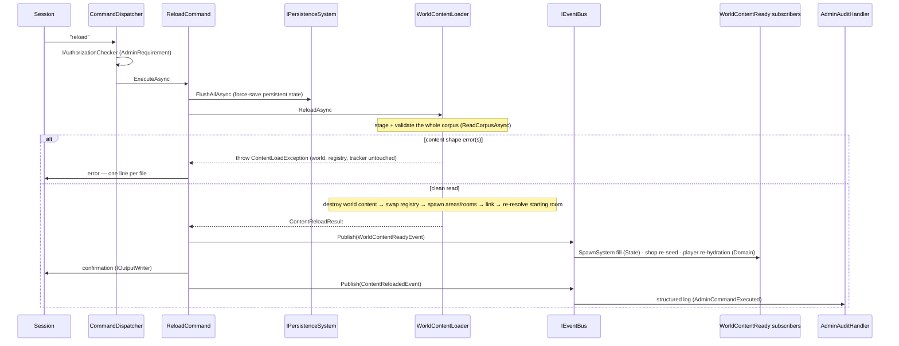

# Flow 5 — Content reload (`reload`)

> [Back to flows index](README.md). **Trigger:** privileged session sends `reload`.

## Summary

`reload` rebuilds the live world instance from YAML the same way a restart does — without dropping connected players. `ReloadCommand` (an Initiator) force-saves all persistent state, then `WorldContentLoader.ReloadAsync` **stages and validates the whole corpus first** — on a content shape error it throws `ContentLoadException` with nothing touched, and the command reports one error line per file and publishes nothing. On a clean read it **tears down every world-content entity** (anything with a `BlueprintComponent` and no `PersistentEntity`), swaps in the staged templates, and re-spawns the areas and rooms via the same spawn/link path the startup load uses. The command then re-publishes `WorldContentReadyEvent`, so the identical post-load fan-out re-runs: `SpawnSystem` (State, first) rebuilds its tracker and refills every rule slot, `ShopkeeperSpawnHandler` re-seeds shop tills + base stock, and `CharacterHydrationHandler` re-resolves each player's `RoomBlueprintId → RoomEntityId` (resetting to the starting room if their room was removed from YAML). Persistent entities (players and player-owned items/containers) are preserved. The result is that runtime instance state is reset — edits take effect, picked-up world items respawn, depleted shops refill, the buy-back shelf clears. Finally `ContentReloadedEvent` is published and `AdminAuditHandler` logs the event.

## Steps

1. **Authorization.** `CommandDispatcher` evaluates `IAuthorizationChecker.IsSatisfied(AdminRequirement, session)` before invoking `ReloadCommand`; unauthorized sessions receive a rejection and the command never runs.
2. **Force-save.** `ReloadCommand` calls `IPersistenceSystem.FlushAllAsync` so all persistent (player + player-owned) state is durable before the world instance is torn down.
3. **Stage and validate.** `ReloadAsync` reads and deserializes every content file into a staging list (`ReadCorpusAsync`) **before** touching anything. Any `ContentShapeException` (legacy `spawnRoomBlueprintId`/`spawnRoomId`, a `minCount`/`maxCount` rule, a malformed rule, a malformed or partial area `designation`) is collected; if any were, it throws `ContentLoadException` listing every file. **Refusal branch:** `ReloadCommand` catches it, writes the per-file error list, and returns — no teardown, no `WorldContentReadyEvent`, no `ContentReloadedEvent`; the live world, registry and `SpawnSystem` tracker are unchanged (the earlier flush is harmless). The web host's Apply shows the same message.
4. **Tear down world content.** `WorldContentLoader.ReloadAsync` destroys every entity carrying a `BlueprintComponent` but not `PersistentEntity` (`DestroyWorldContent`) — rooms, areas, mobs, world/dropped items, shop base stock and buy-back items. Persistent entities are left intact.
5. **Registry swap.** Snapshots previous template ids, clears the registry, and registers the staged templates.
6. **Re-spawn the world.** `SpawnAndPlaceWorld` spawns every **area and room** template fresh, links room exits and links rooms to areas — the same path startup uses. Mobs and found items are not placed here.
7. **Re-resolve the starting room.** `ReloadAsync` ends with `ResolveStartingRoom()`: it re-reads `world.yaml`, re-resolves over the fresh room set, and swaps `WorldConfiguration.StartingRoom` as one new immutable snapshot (an edited manifest takes effect here).
8. **Post-load fan-out.** `ReloadCommand` publishes `WorldContentReadyEvent`. `SpawnSystem` (State 10) clears its tracker and immediately fills every room rule's slots — each id gets its population regardless of rule order; `ShopkeeperSpawnHandler` (Domain 20) then seeds tills + base stock on the rule-placed shopkeepers; `CharacterHydrationHandler` re-resolves each persistent entity's room from its durable `RoomBlueprintId`, moving characters whose room no longer exists to the resolved starting room (one snapshot read).
9. **Result + audit.** `ReloadAsync` returns `ContentReloadResult { loaded, unchanged, removed }` (template-file diff); the command writes a confirmation and publishes `ContentReloadedEvent`; `AdminAuditHandler` (p=80) logs the event.

**Note.** Reload is a full rebuild, so edits to existing rooms/mobs/items now take effect immediately — no restart required. Because world entities are destroyed and re-created, transient combat/effect references to a destroyed mob are dropped (acceptable for an admin maintenance operation). **Concurrency (INV-31).** The staging set is local to one `ReloadAsync` call (confined). The reload-teardown vs heartbeat-respawn race is **pre-existing, acknowledged debt** under the backlog's "World-state threading model" entry: a heartbeat tick can run `SpawnSystem.TryRespawn` against the old tracker between `DestroyWorldContent` and the ready event. In-slice guard: inside the tracker lock, a due slot whose room entity has lost its `RoomComponent` is skipped, so a tick after the room is destroyed spawns no orphan. A tick interleaved *between* individual `DestroyEntity` calls remains (needs the threading decision). See [`../../roadmap/backlog.md`](../../roadmap/backlog.md).

## Where to look

- [`Core/Modules/Admin/Commands/ReloadCommand.cs`](../../../Core/Modules/Admin/Commands/ReloadCommand.cs) · [`Core/Modules/World/Systems/WorldContentLoader.cs`](../../../Core/Modules/World/Systems/WorldContentLoader.cs)
- [`docs/features/world/world.md`](../../features/world/world.md) — world content loading and admin substrate
